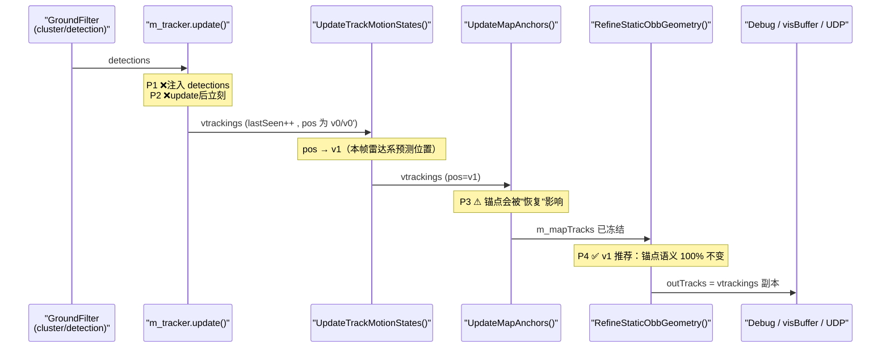

# Local Missing-Target Recheck —— 第一阶段代码分析与设计（STATIC only）

- 对应 Prompt：本轮对话给出的《Local Missing-Target Recheck：第一阶段代码分析与设计 Prompt》
- 本文档性质：**纯分析，未修改任何源码**；所有行号/字段/调用顺序均已在当前工作区代码中逐条核对
- 口径标记：`[已验证]` = 读代码确认；`[需实测]` = 需跑数据确认；`[设计]` = 本文档提出的新设计
- 命名原则（遵守 Prompt 第三节）：本设计**不复用** `GridCell::is_obstacle_candidate` 的语义，全部使用独立命名
  （命名前缀统一 `Recheck*` / `RECOVERED`），并对现有 `is_obstacle_candidate` 保持**零写入**。

---

## 〇、任务边界（实现层保证，不靠"注意"）

本阶段**只做**：

```text
STATIC Track
  + 本帧 main detection miss（lastSeen >= 1）
  + pose 有效 && has_map_pos
        ↓
Local Missing-Target Recheck（一次 Raw Point Scan）
        ↓
RecheckEvidence → RecoveredCandidate（DetectionSource::RECOVERED）
        ↓
写回该 Track 自身状态（不 re-run tracker、不新增 ID）
```

| Prompt 第二十条禁止项 | 本分析的实现层保证 |
|---|---|
| UNKNOWN / MOVING Recheck | 硬门：`if (t.motion_state != MotionState::STATIC) continue;`，无其它分支 |
| 修改 Ground Filter 主算法 | **不进入** `ElevationMapGroundFilter` 任何函数；只调用其**只读** getter（`GetGrid/GetConfig/GetGridCols/GetEffectiveRoiXMin`） |
| 修改 Grid resolution | 不新增/不修改 `ElevationGridConfig` 任何字段 |
| 修改 Cluster minimum cell threshold | `min_cluster_cells` 一行不动；Recheck 判定**完全不使用**该阈值 |
| 修改 HDMap / Localization / UDP | 不触碰 `hdmap_filter` / `LocalizationManager` / `ConvertTrackToS2ObstacleBox` |
| 历史轮廓融合 / 3D 重建 / 点云累积 | 只消费**本帧** raw cloud 与**本帧** Grid；无跨帧点云缓存 |
| Kalman / EMA / Hungarian / JPDA / MHT | 不新增任何滤波/分配算法；只有计数器与阈值比较 |
| 修改 `UpdateMapAnchors()` miss 语义 | 插入点选在 `UpdateMapAnchors()` **之后**（见第三节），该函数代码路径与今天**完全一致** |
| 综合评分 / confidence | 判定为**纯布尔与门**（第十二节），无权重、无 score、无浮点置信度 |
| `N_track × N_point` 双层循环 | 结构上不可能：raw 点只扫**一次**，通过 `recheckMask[cell]` 位运算路由（第七~九节） |

---

## 一、当前代码实际数据流（帧内时序）`[已验证]`

### 1.1 帧内真实调用顺序（`pcapRunningModel / onlineModel` 路径）

| # | 步骤 | 位置 | 关键数据 |
|---|---|---|---|
| 1 | 取点云消息 → 组装 `pInputCloud` | `SuTengDriver.cpp:889` 起 | `msg->points` |
| 2 | `PointCloudTransform()`（坐标系换到主雷达系 + Body/ROI 过滤） | `:285` 定义 | `pFilteredPointCloud` |
| 3 | `ProcessWithObstacleDetection(pFilteredPointCloud, pGroundCloud, pObstacleCloud, outputClusters)` | `:1015` | **raw→grid→ground→obstacle→cluster** 一条链 |
| 4 | 读定位一次 | `:1024` | `loc_pose` / `have_pose` |
| 5 | HDMap 软约束打标签 | `:1030~1050` | `outputClusters[].in_road` |
| 6 | `ConvertClustersToTrackedObstacles()` | `:1059`（定义 `:2320`） | `detections` |
| 7 | **`m_tracker.update(detections, ts)`** | `:1060` | `m_tracker.vtrackings`（V1 贪心，`track.cpp:266`） |
| 8 | **`UpdateTrackMotionStates(loc_pose, have_pose, ts)`** | `:1080`（定义 `:1332`） | 写 `vtrackings` 的 `map_*/motion_*/pos/corners/vx/vy` |
| 9 | **`UpdateMapAnchors(loc_pose, have_pose)`** | `:1088`（定义 `:1240`） | `m_mapTracks`（地图锚点侧表） |
| 10 | `RefineStaticObbGeometry(outputClusters, …, outTracks)` | `:1095`（定义 `:1623`） | `outTracks = m_tracker.vtrackings` 副本 |
| 11 | `AttachRawImageObbs(outputClusters, outTracks)` | `:1100` | `outTracks[].new_corners`（实验） |
| 12 | Historical Feedback（当前被注释） | `:1104~1120` | — |
| 13 | DebugViewer `DrawMapAndAllOverlay(..., outTracks, ...)` / `DrawRawPointImageObbDebug` | `:1129~1156` | 可视化消费 `outTracks` |
| 14 | `m_visBuffer.Publish(pGroundCloud, pObstacleCloud, outTracks)` | `:1193` | 主线程渲染 |
| 15 | `ConvertTrackToS2ObstacleBox(outTracks, …)` + UDP 发送 | `:1203` | **下游规划** |

> `pcdRunningModel` 路径在 `:2499` 有另一套同样的 tracker 调用（单帧调试），本设计第一版只挂 `ProcessPcapCloud`（见第二十一节）。

### 1.2 `ProcessWithObstacleDetection` 内部（`ElevationMapGroundFilter.cpp:971`）

```text
BuildGrid(:148)                 → GridCell{min_z,max_z,mean_z,point_num,valid}    [1 次全点云]
ComputeGroundHeight(:375)
ComputeSlope(:427)
RegionGrowing(:564)             → label
GenerateGroundMask(:789)        → is_ground
ComputeGroundReference(:1097)   → 逐列 ground cell min_z 中位数 → 插值 → 平滑 → ground_reference_z / top_height
AnalyzeVerticalOccupancy(:1425) → height_range / layer_histogram / occupied_layers
                                → is_vertical_structure / is_obstacle_candidate  ← 【主 Ground Filter 的判定】
                                → 末尾调用 ReclassifyPointCloud(:1850)
ClusterObstacleGrid(:1989)      → is_obstacle_candidate 的 8 邻域 BFS，< min_cluster_cells(3) 丢弃
                                → BuildClusterFromCells(:2209) / ComputeRawImageOBB(:2473)
```

### 1.3 与本设计强相关的现有事实

| 事实 | 位置 | 对 Recheck 的意义 |
|---|---|---|
| Grid 每帧 `clear()+resize()` 完全重建 | `:189~190` | Recheck 读到的 `GridCell` 一定是**本帧**数据，无跨帧残留 |
| `GroundMask` 里 `is_interpolated_ground` 恒为 `false`（插值分支被注释，见 `:655~700`） | `:789` | 排除插值地面目前是"零成本空操作"，但语义上仍应写 |
| `GridCell::ground_reference_z` 是**逐列**（按 x）中位数 + 插值 + 3 点平滑 | `:1097~1425` | 同一 col 内所有 row 的值相同 → 局部（y 方向）分辨率粗，不能当作"该 cell 的真实地面" |
| `ReclassifyPointCloud` 中 `is_ground && z > ground_reference_z + 0.05` → `obstacle_cloud`（判定点 `:1905`） | `:1900~1915` | **Case A 的根因**：目标 cell 被 RegionGrowing 吸收成 `is_ground` 后，只要其点 z 不高于列中位数 +5cm，就全部进 `ground_cloud` |
| `ClusterObstacleGrid` 硬过滤 `cells < min_cluster_cells(3)` | `:2058` | **Case B 的根因**：1~2 cell 的障碍物永远没有 cluster |
| `obstacle_cloud` 是"全部非地面点"，不是"低矮障碍物点" | `:1890~1945` | Recheck **不能**只消费 `obstacle_cloud`（Case A 中它根本不含目标点） |
| `TrackedObstacle` 的拷贝构造/赋值是**手写**的 | `track.h:120~240` | 新增字段必须两处同步（`current_exist` 的历史教训已写在注释里） |
| `cluster_id` 是**帧内局部编号** | `:1989~2060` | ★ 恢复时必须清 `cluster_id`，否则会与 `RefineStaticObbGeometry` 的 `cluster_by_id` 发生**跨帧碰撞**（第十八节坑 1） |
| EMX 配置下 Grid = 80 rows × 167 cols = **13360 cells** | `debug_config_EMX.yaml` + `BuildGrid:170` | 与 Prompt 第十节给的量级一致（`eff_x_min = max(0, 0.8+2.5) = 3.3m`） |

---

## 二、当前 STATIC miss 的真实时序 `[已验证]`

### 2.1 `SimpleTracker::update()` 的三条分支（V1，`track.cpp:266`）

| 分支 | 条件 | 对 state 的作用 |
|---|---|---|
| ① 空 detections | `detections.empty()`（`:281`） | **所有** track：`pos += v*dt`、`corners += v*dt`、`lastSeen++`、`current_exist=false` |
| ② 非空 + 匹配成功 | `cost < match_threshold(0.5)`（`:369`） | `pos_z/depth/width/height/corners/Translation/Rotation` 全量取自 detection，`v=(new-old)/dt`，`age++`，`lastSeen=0`，`cluster_id=detection.cluster_id`，`current_exist=true` |
| ③ 非空 + 未匹配 | 否则（`:429`） | **只** `lastSeen++`、`current_exist=false`（**位置不动**） |
| ④ 新建 track | 未匹配的 detection（`:449`） | `new id = nextTrackID++`，`age=0`，`lastSeen=0` |
| ⑤ `removeLongLostTargets()` | `lastSeen > 10`（`:493~499`） | 删除 |

### 2.2 关键结论：miss 帧的"当前雷达系位置"在何时才存在

`UpdateTrackMotionStates()`（`:1332`）内部有两个分支：

- **matched 分支**（`:1355`，`t.lastSeen == 0 && pose_valid`）
  → `vehicleToMap(pos)` → 更新 `map_x/map_y`、`map_vx/map_vy`、`motion_step/net/dir`、状态机、`map_yaw_deg`。
- **miss 分支**（`:1485`，`else if (pose_valid && t.has_map_pos)`）
  → `mapToVehicle(map_x, map_y, 当前 pose)` → **覆盖 `pos_x/pos_y`** → 用 `map_yaw_deg`（或旧角点反算）重建 `corners` → 写回自洽的 `vx/vy`。

因此：

```text
[已验证]  miss 帧的 Track 位置有三个"版本"：
  v0: tracker.update() 之后（分支①）= 上一帧 pos + v*dt 外推（无位姿，退化近似）
  v0': tracker.update() 之后（分支③）= 上一帧 pos（完全没动）
  v1: UpdateTrackMotionStates() 之后 = 地图锚点 → 当前帧雷达系（真实当前帧预测位置）★
```

⇒ **Recheck 的 ROI 中心必须取 `v1`**，所以 Recheck 必须放在 `UpdateTrackMotionStates()` **之后**。
（Prompt 第七条"请仔细检查实际调用顺序"的答案：该结论成立，但仅在 `pose_valid && has_map_pos` 时成立。）

> ⚠ 现实约束：当前 `config/debug_config.yaml` 里 `Localization.enable: 0` ⇒ `have_pose == false` ⇒ miss 分支**不执行**，
> Track 位置停留在 `v0/v0'`。此时若自车在动，`v0/v0'` 与真实当前帧位置可差 0.1~0.5m（见第二十节 T3 与第二十二节 Q1）。

### 2.3 一个必须点明的既有语义

`UpdateTrackMotionStates()` 的 miss 分支**不 coast** 地图位置、**不**追加 `recent_map_positions`
（`:1494~1497` 注释：重投影不是观测，不污染运动证据）。本设计**继续遵守**这一点：
Recheck 恢复后也**不**追加历史/不伪造运动证据（第十五节）。

---

## 三、Recheck 最合理的插入位置（本设计必须回答的核心问题）

### 3.1 四个候选插入点



### 3.2 逐点评估

| 位置 | 可行性 | 结论 |
|---|---|---|
| **P1：`m_tracker.update()` 之前，把恢复结果注入 `detections`** | ❌ 拒绝 | 4 个硬伤：(a) 此刻**不知道本帧谁会 miss**（`lastSeen` 还是上次的值），只能对"上次已 miss"的 track 做，**首次漏检那一帧必然漏掉**，而 Prompt 的场景恰恰是 `N 正常 / N+1 漏检 / N+2 正常`；(b) 此刻没有 `v1`，必须自己再写一遍 `mapToVehicle` 预测；(c) 若该 track 本帧其实有正常 cluster（Case 边界），注入的额外 detection 会**匹配不到任何 track → 多出一个新 ID**（虚假轨迹）；(d) `cluster_id` 会被写成合成值，污染 `RefineStaticObbGeometry` 的 cluster 查找。 |
| **P2：`update()` 之后、`UpdateTrackMotionStates()` 之前** | ❌ 拒绝 | 拿不到 `v1`；若自己算 `mapToVehicle`，等于把 miss 重投影逻辑复制一份，形成第二套真值来源。 |
| **P3：`UpdateTrackMotionStates()` 之后、`UpdateMapAnchors()` 之前** | ⚠ 可行但非首选 | 能拿到 `v1`。副作用：恢复把 `lastSeen` 置 0 → `UpdateMapAnchors()` 会走 **matched 分支**，把恢复几何重新锚定到地图系。对静态目标数值上几乎无差（地图位置本来不动），但这**间接改变了 `UpdateMapAnchors()` 的可观测行为**，与 Prompt 第八条"不要修改其 miss 语义"的字面要求冲突。 |
| **P4：`UpdateMapAnchors()` 之后、`RefineStaticObbGeometry()` 之前** ✅**v1 推荐** | ✅ 推荐 | `UpdateMapAnchors()` 的执行路径与今天**逐字节一致**（恢复发生在它之后，本节末）。同时仍在 `RefineStaticObbGeometry()`（`:1095`）之前，所以恢复后的几何能通过 `outTracks = m_tracker.vtrackings`（`:1629`）自然流向 Debug / visBuffer / UDP。 |

**v1 采用 P4。** 具体落点：

```cpp
// SuTengDriver.cpp:1088 之后、:1095 之前
UpdateMapAnchors(loc_pose, have_pose);
    }                                     // ← 现有 tracker 块结束

// ★ 新增：Local Missing-Target Recheck（STATIC only，post-association repair）
RunLocalMissingTargetRecheck(*pFilteredPointCloud, outputClusters);

std::vector<TrackedObstacle> outTracks;
RefineStaticObbGeometry(outputClusters, loc_pose, have_pose, outTracks);   // :1095
```

### 3.3 直接回答："Recovered Candidate 是否要重新进入 `m_tracker.update()`？"

**不要。** 本设计采用 **"post-association repair（关联后修复）"**：

```text
recovered 只是把【已经存在的那条 Track】
从 "本帧 miss" 状态修成 "本帧观测到" 状态：
    lastSeen = 0 ; current_exist = true ; age++ ;
    detection_source = RECOVERED ; cluster_id = -1 ;
    (可选) corners/depth/width ← 本帧 recheck 点
不调用 m_tracker.update()、不新增 ID、不注入 detections、不重跑关联。
```

理由：

1. **Track 已经存在**：恢复的对象是 `vtrackings` 里已有的 track，"重新进 tracker"没有语义收益，只有风险。
2. **重跑 update 会破坏时序**：`update()` 的 `delta_time` 来自 `g_previousTimestamp`（帧末才更新），二次调用会让 `age/lastSeen/v` 双计，且第二次匹配会把已匹配的 track 重新参与贪心分配。
3. **不重跑就不会有虚假新 ID**：若走 P1 注入 detection，Case 边界（目标本帧其实有正常 cluster）会额外产生一条 track。
4. **不需要重跑**：恢复所需的全部信息（`v1` 位置、`map_*`、历史几何）在这一步都已就绪；唯一"遗漏"的是关联步——而这条 track 本帧本来就没被关联上。
5. **生命周期仍然只由既有机制决定**：`lastSeen` / `removeLongLostTargets()`（`track.cpp:493`）一行不改，Recheck 不负责删除（Prompt 第十五、十六条）。

---

## 四、Recheck 的输入数据清点 `[已验证]`

| 类别 | 具体来源 | 接口/变量 | 用途 |
|---|---|---|---|
| **Raw Point Cloud** ★ | 主 Ground Filter 的**同一份输入** | `*pFilteredPointCloud`（`SuTengDriver.cpp:1015` 传进去的那份） | 唯一证据来源。**Case A 中 `obstacle_cloud` 是空的，必须靠它** |
| Grid | `const std::vector<GridCell>&` | `m_pElevationMapGroundFilter->GetGrid()`（`ElevationMapGroundFilter.h:465`） | 取 `is_ground / is_interpolated_ground / is_obstacle_candidate / min_z / max_z / ground_reference_z / top_height / valid / point_num` |
| Grid 几何 | rows/cols/eff_x_min/res/roi_y_min | `GetGridRows()` / `GetGridCols()` / `GetEffectiveRoiXMin()` / `GetConfig()` | 与 `WorldToGrid`（`:281`）同一坐标约定，**不自己发明映射** |
| Track | `m_tracker.vtrackings` | `id / motion_state / lastSeen / age / pos_x / pos_y / depth / width / corners / map_x / map_y / has_map_pos / has_map_yaw / map_yaw_deg / cluster_id` | 选 track、定 ROI 中心、OBB 回退源 |
| 位姿 | `loc_pose` / `have_pose` | 已在 `:1024` 读好 | 门控（ROI 中心有效性） |
| 本帧 cluster | `outputClusters`（`cell_indices`） | `GridCluster::cell_indices` | **排除**已被本帧正常检测覆盖的 cell（避免把邻居目标的点记到本 track 上） |
| Cluster 关联 | `t.cluster_id` | — | 判断该 track 本帧是否已匹配（`lastSeen==0` 即已匹配，直接跳过） |

**明确不使用**（避免复制 Ground Filter 能力、避免语义混淆）：

- `obstacle_cloud`（Case A 为空；且它含高大物体点，不是"低矮障碍物点"）
- `m_rawPointImage` / `m_rawPointCounter`（`ReclassifyPointCloud` 里只栅格化**被判为 obstacle** 的点 → Case A 下同样为空）
- `m_historicalFeedback` / `m_mapTracks` 的历史几何轮廓（Prompt 第十二条：第一阶段不做历史轮廓重建）
- 不调用 `RegionGrowing / GenerateGroundMask / ComputeGroundReference / ComputeSlope / WorldToGrid` 的**写路径**，只读其结果

---

## 五、RecheckEvidence 建议结构 `[设计]`

放在新文件 `include/local_recheck.h`（header-only，与 `track_motion_state.h` / `static_obb_refinement.h` 的既有风格一致，
不引入新依赖、不改 CMake：`AUX_SOURCE_DIRECTORY(./include SRC)` 只收 `.cpp`）。

```cpp
// ---- 独立命名空间，与 GridCell::is_obstacle_candidate 彻底切割 ----
enum class RejectReason : uint8_t {
    NONE = 0, NOT_STATIC, ALREADY_MATCHED, NO_POSE, NO_MAP_POS, ROI_OUT_OF_GRID,
    NO_GROUND, TOO_FEW_POINTS, HEIGHT_OUT_OF_RANGE, BELOW_GROUND, NO_CELL_SUPPORT, DISABLED
};

enum class RecheckGroundSource : uint8_t { RING_MEDIAN = 0, CELL_REF_FALLBACK, NOMINAL_FALLBACK, INVALID };
enum class RecoveredObbSource  : uint8_t { NONE = 0, CURRENT_RECHECK, PREVIOUS_GEOMETRY };

// 每个"候选 track"的槽位（最多 kMaxRecheckTracks 个）
struct RecheckSlot {
    int  track_index = -1;      // vtrackings 下标
    uint32_t bit     = 0;       // 1u << slot
    // ---- ROI（Grid cell 索引，含边界）----
    int  roi_r0 = 0, roi_c0 = 0, roi_rows = 0, roi_cols = 0;
    int  core_r0 = 0, core_c0 = 0, core_rows = 0, core_cols = 0;   // 目标自身足迹（不用于取地面）
    float center_x = 0.0f, center_y = 0.0f;                       // = t.pos_x/pos_y (v1)
    // ---- Local Ground Reference ----
    RecheckGroundSource ground_src = RecheckGroundSource::INVALID;
    bool  ground_valid = false;
    int   ground_cell_count = 0;
    float local_ground_z = 0.0f;
    float ground_spread  = 0.0f;   // ring ground cell min_z 的 max-min
    // ---- Raw Point 证据 ----
    int   raw_point_count   = 0;   // 落在 ROI 内的全部 raw 点
    float min_z = FLT_MAX, max_z = -FLT_MAX;
    float min_residual = FLT_MAX, max_residual = -FLT_MAX;  // residual = z - local_ground_z
    int   abnormal_point_count = 0;                          // residual >= kMinResidual
    std::vector<uint8_t> cell_hits;   // 局部占用计数（abnormal 点），尺寸 roi_rows*roi_cols
    int   occupied_cell_count = 0;
    int   max_cell_hits = 0;
    int   max_component_cells = 0;    // 8 邻域连通（空间一致性，只做诊断/布尔门）
    std::vector<pcl::PointXYZI> pts;  // abnormal 点，上限 kMaxStoredPoints
    // ---- 结果 ----
    bool accept = false;
    RejectReason reject = RejectReason::NONE;
};

// 一次 Recheck 的汇总（日志/可视化用）
struct RecheckFrameSummary {
    int candidate_tracks = 0, accepted = 0, slots_truncated = 0;
    int scanned_points = 0, roi_hit_points = 0;   // roi_hit = mask!=0 的点数
};
```

**设计要点（与 Prompt 第十四条对应）**：

- `raw_point_count / min_z / max_z` = Raw Point 层
- `local_ground_z / min_residual / max_residual` = Ground Residual 层
- `occupied_cell_count / max_cell_hits / max_component_cells` = Grid 层（`occupied_layers / height_range` 只在日志里附带打印，不参与判定）
- 空间邻接关系**只保留"最大连通分量 cell 数"这一个整数**，不构建图/不设计 score

---

## 六、Grid ROI 如何构建 `[设计]`

### 6.1 中心

```text
中心 = (t.pos_x, t.pos_y)   // P4 位置下 = UpdateTrackMotionStates 的 miss 分支写好的 v1
                                （pose_valid && has_map_pos 硬门已保证）
```

### 6.2 ROI / core 尺寸（全部以 cell 为单位，避免"拍脑袋"的米制常数）

```text
res          = cfg.grid_resolution                // 0.1 m
obj_half_m   = 0.5 * max(t.depth, t.width)        // 目标半尺寸（RAW 几何，退化时取 0.15）
core_half_c  = max(1, ceil(obj_half_m * inv_res) + 1)      // 目标足迹 + 1 cell 护栏
roi_half_c   = clamp(core_half_c + kRoiMarginCells, 4, 12) // kRoiMarginCells = 3 → 额外 0.3 m
```

依据（回答 Prompt 第十二条"请结合现有参数分析"）：

| 误差源 | 量级 | 取值依据 |
|---|---|---|
| Grid 量化 | ±0.05 m（1 cell = 10 cm） | 取 cell 整数 → 天然覆盖 |
| 静态预测误差（地图锚点 → `mapToVehicle`） | 0.05~0.2 m `[需实测]`，受定位精度/地图对准残差影响（已知 HDMap 对准残差 ~0.92 m 属地图层，不影响雷达系预测） | 3 cells = 0.3 m 余量 |
| 目标尺寸 | 0.1 ~ 0.6 m | `core` 由 `t.depth/width` 自适应 |
| 点云插值/边界 | ±1 cell | 上限 12 cells = 1.2 m，下限 4 cells = 0.4 m |

⇒ EMX 配置下典型 ROI = `(2*roi_half_c+1)²` ≈ 121 cells（1.1 m × 1.1 m）。

### 6.3 出界处理

- `WorldToGrid(center)` 失败（中心在有效 ROI 外，例如 `x < eff_x_min = 3.3 m` 的车身盲区）→ **拒绝该 track**（`ROI_OUT_OF_GRID`），并计数打日志。
- ROI 的 row/col 边界 clamp 到 `[0, rows-1] / [0, cols-1]`，被裁掉的部分不参与统计。

### 6.4 core 与 ring 的分工（本设计的关键之一）

```text
ROI   = core ∪ ring
core  = 目标自身足迹（+1 cell）    → 【不用于采样地面】，因为 Case A 中目标自己的 cell 就可能被误标成 is_ground
ring  = ROI \ core                 → 【唯一的地面采样源】
```

---

## 七、`recheckMask[cell]` 数据结构 `[设计]`

### 7.1 选型

```cpp
// SuTengDriver 成员（跨帧复用，避免每帧分配）
std::vector<uint32_t> m_recheckMask;      // size = rows*cols，每个 bit = 一个 RecheckSlot
std::array<RecheckSlot, kMaxRecheckTracks> m_recheckSlots;   // kMaxRecheckTracks = 32
std::vector<uint8_t>  m_cellOccupiedByCluster;  // size = rows*cols，本帧已被正常 cluster 占用的 cell
```

| 方案 | 内存（EMX, 13360 cells） | 每帧清零成本 | 结论 |
|---|---|---|---|
| `uint32_t` per cell | 53.4 KB | `std::fill` ~4 µs | ✅ **推荐**（32 track 槽足够 Prompt 给的 10~20 甚至翻倍） |
| `uint64_t` per cell | 106.8 KB | ~8 µs | 备选（>32 track 时一行改动即可升级） |
| `vector<vector<int>>` per cell | 24B×13360 = 320 KB + 每帧 heap 抖动 | 差 | ❌ 直接排除（Prompt 第十节提出的正是要避免这种结构） |

> 为什么**不是** `13360 cells × Track` 的二维结构：那样光清零就是 `13360×20`，且每个 cell 的 vector 会带来
> 每帧 `clear/resize` 的隐藏开销；位掩码把"一个 cell 属于哪些 track"压成 4 字节，且支持天然的多 track 共存
> （Prompt 第十节的 `cell 100: Track A | Track C`）。

### 7.2 槽位分配与截断

```text
slot ∈ [0, 31]，bit = 1u << slot
候选筛选顺序 = vtrackings 遍历顺序，取前 32 条满足：
    motion_state == STATIC
    && lastSeen >= 1                 // 本帧 miss（tracker 刚写）
    && pose_valid && t.has_map_pos
    && t.age >= kMinAgeForRecheck    // 见 12.3（STATIC 本身已隐含 ~4 帧历史）
超出 32 条：丢弃并 `slots_truncated++`，打一条 WARN 日志（第一版不做多播）。
```

---

## 八、一次 Raw Point Scan 的具体流程 `[设计]`

```text
RunLocalMissingTargetRecheck(rawCloud /* = *pFilteredPointCloud */, clusters)
│
├─ S0 开关/前置
│    if (!cfg.enable) return;                      // 默认关闭 → 零行为变化
│    if (rawCloud.empty()) return;                 // BuildGrid 已失败时这里也空
│
├─ S1 清空跨帧缓冲（O(Grid)，非 O(Grid×Track)）
│    m_recheckMask.assign(rows*cols, 0);
│    m_cellOccupiedByCluster.assign(rows*cols, 0);
│    for (slot : m_recheckSlots) slot = RecheckSlot{};   // pts/cell_hits 由使用的 slot 自行 clear
│
├─ S2 标记"已被正常 cluster 覆盖"的 cell（O(Σ cluster cells)）
│    for (cl : clusters) for (idx : cl.cell_indices) m_cellOccupiedByCluster[idx] = 1;
│    （这些 cell 的点已经由一条正常 track 代表，不再作为其它 track 的恢复证据）
│
├─ S3 选候选 track + 建 ROI + 采局部地面（O(T × ROI)）
│    见 §5/§6/§10
│    if (接受候选) 把 slot 的 bit 写入 mask 的 ROI 每个 cell：m_recheckMask[idx] |= bit;
│
├─ S4 ★ 只扫一次 raw cloud（O(N)）
│    for (p : rawCloud.points)
│        if (!finite(p)) continue;
│        if (!WorldToGrid(p.x,p.y,row,col)) continue;     // 复用 GroundFilter 的同一映射
│        idx = row*cols + col;
│        uint32_t m = m_recheckMask[idx];
│        if (m == 0) continue;                             // ★ 绝大多数点在这里直接跳过
│        for each set bit s in m: accumulate(slot[s], p);
│
├─ S5 后处理：连通性 + 判定 + 生成 RecoveredCandidate（O(T × ROI)）
│    见 §12/§13
│
└─ S6 汇总日志 + 可选 DebugViewer
```

`accumulate()` 的具体动作（Prompt 第九条）：

```cpp
slot.raw_point_count++;
slot.min_z = min(slot.min_z, p.z);   slot.max_z = max(slot.max_z, p.z);
float res = p.z - slot.local_ground_z;
slot.min_residual = min(...);        slot.max_residual = max(...);
if (res >= kMinResidual) {                        // "异常于局部地面"的点
    slot.abnormal_point_count++;
    int lr = row - slot.roi_r0, lc = col - slot.roi_c0;
    slot.cell_hits[lr*slot.roi_cols + lc]++;      // 局部占用
    if (slot.pts.size() < kMaxStoredPoints) slot.pts.push_back(p);   // 供 OBB
}
```

---

## 九、Raw Point 如何通过 GridCell mask 进入对应 Track Evidence

```text
200k RAW points ──ONE PASS──► WorldToGrid(idx) ──► recheckMask[idx] ─┬─ ==0 ─► skip（~98~99% 的点）
                                                                      └─ !=0 ─► 遍历置位的 bit ─► 对应 RecheckSlot 累加
```

- **一个点可以同时属于多个 track**（ROI 重叠时，多个 bit 同时置位）→ 逐 bit 累加，天然支持"ROI 重叠"。
  代价 = `popcount(mask)`，而只有落在 ROI 内的点（约 1~2%）才会 >= 1。
- **不使用**"cell 中心 → 找 track"的间接查表（会引入额外量化误差）；直接用点自身坐标算 residual。
- `WorldToGrid` 的语义与 `ElevationMapGroundFilter` 完全一致：
  `row = floor((y - roi_y_min)/res)`，`col = floor((x - eff_x_min)/res)`，半开区间 `[min, max)`
  → ROI 与 Grid 的 cell 边界严格对齐，不需要任何偏移补偿。
- `m_cellOccupiedByCluster[idx] == 1` 的点：**仍参与 `raw_point_count`，但不参与 `abnormal` 与 OBB**
  （避免把已被正常 track 认领的目标当成恢复证据，见第二十节 T6）。

---

## 十、Local Ground Reference 的获取方法（逐条回答 Prompt 第十三条）

```text
输入：ring = ROI \ core 的 GridCell
步骤：
  1) 遍历 ring 的每个 cell，只要满足【全部】条件即计入 ground 样本：
        cell.valid
     && cell.is_ground
     && !cell.is_interpolated_ground            // ← Q1
     && !cell.is_obstacle_candidate             // ← Q2（排除"mixed ground cell"）
     && cell.point_num >= cfg.min_points_per_cell
     && fabs(cell.min_z - cell.ground_reference_z) <= kGroundCellZDiffMax (0.15m)  // 列异常保护
  2) local_ground_z = 样本 cell.min_z 的中位数（Q5：中位数，不是均值）
     ground_spread  = 样本 cell.min_z 的 (max - min)
  3) ground_valid = (样本数 >= kMinGroundCells(=3)) && (ground_spread <= kGroundSpreadMax(=0.15m))
```

逐条回答：

| Prompt 问题 | 结论 | 理由 |
|---|---|---|
| 1. 如何排除 `is_interpolated_ground` | `&& !cell.is_interpolated_ground` 硬排除 | 该 cell **没有真实地面点**，`min_z` 是插值产物，不能当观测。`[已验证]` 当前实现恒为 `false`（`:655~700` 的插值分支被注释），但语义上必须写，未来开启时自动正确 |
| 2. 如何排除无效 Ground Cell | `valid && !is_obstacle_candidate` + `min_z` 与列参考一致性检查 | `valid=false` 的 cell `min_z=FLT_MAX`（`:256~266` 被重置）；`is_obstacle_candidate==true` 说明主流程对该 cell 已有"障碍物"证据，不该当地面 |
| 3. Ground Cells 太少怎么办 | 三级 fallback，且**降级后不放宽判定**：① `CELL_REF_FALLBACK`：用 core 中心 cell 的 `ground_reference_z`；② `NOMINAL_FALLBACK`：`cfg.sensor_height_nominal`（=主雷达安装高度，`SuTengDriver.cpp:80`，≈-1.39）；③ `ground_valid=false` → **直接拒绝该 track** | Recheck 的目的是"确认存在"，地面不可信时宁可漏恢复，也不制造误恢复（Prompt 第十五条：禁止用复杂 score 兜底） |
| 4. 地面高度变化明显时怎么办 | `ground_spread <= 0.15 m` 才 `ground_valid` | 0.15 m ≈ 1.5 cell，覆盖常规坡度（`slope_threshold=0.35` 在 1.1 m ROI 内允许 ~0.2 m 落差，故取 0.15 偏保守）；超过说明 ROI 跨了坡/路缘，中位数已不可代表局部地面 |
| 5. 是否用周围多个 Ground Cell 的 median | ✅ 用 `min_z` 的中位数 | 中位数对单个误标 cell 鲁棒（与 `ComputeGroundReference` 每列用中位数的既有哲学一致）；用 `min_z` 而不是 `mean_z` 也与 Elevation Mapping 的经典做法一致（`:120~140` 注释） |
| 6. 是否可以直接复用现有 `ground_reference_z` | 作为 **fallback**，不作为主估计 | `ground_reference_z` 是**逐列**（按 x）中位数 + 插值 + 3 点平滑：同一 col 内所有 row 共用一个值 ⇒ y 方向分辨率 = 整条列（最坏 8 m），且已被平滑。对 0.1~0.5 m 的低矮目标，误差可能直接吃掉目标高度 |

**为什么 core 必须排除（Case A 的自污染防护）**：Case A 的成因就是目标 cell 被 RegionGrowing 吸收为 `is_ground`
（`:789` 之后 `GenerateGroundMask`），其 `min_z` ≈ 目标顶面高度。若把 core 计入地面样本，
`local_ground_z` 会被抬到目标顶面 → `residual ≈ 0` → **永远恢复不了**。ring-only 采样是本设计最关键的一步。

---

## 十一、Case A / Case B 如何统一

| | Case A | Case B |
|---|---|---|
| 现象 | `obstacle_cloud` 里没有任何目标点 | 存在 1~2 个 `is_obstacle_candidate` cell |
| 卡在哪一步 | `ReclassifyPointCloud`：目标点在 `is_ground` cell 中且 `z <= ground_reference_z+0.05` → 进 `ground_cloud`（`ElevationMapGroundFilter.cpp:1900~1915`） | `ClusterObstacleGrid`：`cells < min_cluster_cells(3)` → 丢弃（`:2058`） |
| ⇒ 共同结果 | `detections` 里没有该目标 → `SimpleTracker` 判 miss（`track.cpp:429` 或 `:281`） | 同左 |
| Recheck 看到的数据 | `raw point`（本帧**仍然存在**）+ ring ground | `raw point` + ring ground |
| Recheck 判定 | `residual = z - ring地面中位数` 明显 > 0 → 证据成立 | 完全相同的公式 |

⇒ **两 Case 走完全相同的代码路径**：都以"本帧 raw cloud + 局部地面参考"为唯一证据来源，
不区分"主流程判了 ground 还是判了 obstacle_candidate"，也**不检查** `is_obstacle_candidate`。
因此两 Case 天然统一（Prompt 第十七条）。

**为什么不能复用"至少 3 cells"**：Case B 恰恰只有 1~2 cell，而 Case A 可能 1 cell 都没有。
Recheck 的门槛必须允许 `1 cell`（Prompt 第十六条），并用其它自然约束防噪（第十二节）。

---

## 十二、Recheck Candidate 如何产生（无 score）

### 12.1 判定（纯布尔与门）

```cpp
// ---- 硬门（任一不满足即拒绝）----
bool accept =
        slot.ground_valid                                   // 地面可信（§10）
     && (slot.abnormal_point_count >= kMinAbnormalPoints)    // 默认 2
     && (slot.max_component_cells >= kMinComponentCells       // 默认 2（8 邻域连通）
         || slot.max_cell_hits >= kMinPointsPerCell)          // 或 单 cell 至少 4 点
     && (slot.max_residual >= kMinResidual)                   // 默认 0.03 m（≥3cm 高于局部地面）
     && (slot.max_residual <= kMaxResidual)                   // 默认 top_height_max_far + 0.10 （EMX: 0.50）
     && (slot.min_residual >= -kBelowGroundTol);              // 默认 0.05 m（排除整体低于地面/下沉）
```

参数默认值（全部 header 常量，与 `track_motion_state.h` 的风格一致）：

| 常量 | 默认 | 含义与依据 |
|---|---|---|
| `kMinAbnormalPoints` | 2 | "1 个随机噪声点"不足以通过；2 点是本设计允许的最小统计重复 |
| `kMinComponentCells` | 2 | 空间一致性：至少 2 个 8 邻域相连的 cell（Prompt 第十四条"空间邻接关系"的最小可用形式） |
| `kMinPointsPerCell` | 4 | 当只有 1 个 cell 时的替代条件（同一 cell 内多次回波 = 更可信） |
| `kMinResidual` | 0.03 m | 低于 3 cm 与地面自身噪声/坡度无法区分（`height_range>=0.02` 是主流程的同类门槛） |
| `kMaxResidual` | `obstacle_top_height_max_far + 0.10` | 与主流程同一语义上限；+0.10 是给"被吸收成 ground 后 ground_ref 被抬高"留的余量。**用途：把行人腿部/高大物体挡在门外**（与 `TallNeighborFilter` 同目的，但不复用其代码） |
| `kBelowGroundTol` | 0.05 m | `min_residual` 太负说明 ROI 里主要是低于地面的点（坑/下坡/地面估计错误） |
| `kMinAgeForRecheck` | 3 | Track 历史存在性约束（Prompt 第十六条）。`[已验证]` STATIC 状态本身要求 `kMotionUnknownToStatic=4` 帧静止证据，所以已满足；显式写出只是防御 |

### 12.2 为什么不做综合评分（Prompt 第十五条）

```text
评分/置信度的问题：
  - 需要调权重 → 每换一个雷达/安装/场地都要重调 → 不可解释、不可回归
  - "> 0.73" 这类阈值没有物理量纲，无法从代码推导，只能靠数据拟合
本设计的回答：Recheck 的职责只有一句话 ——
  "这条已知 Track 在当前帧的局部区域里，是否还有异常于局部地面的点云证据？"
  ⇒ 布尔输出，其余全部交给既有 lastSeen / removeLostTargets 生命周期机制。
```

### 12.3 噪声抑制的"自然约束"（替代 score）

| 约束 | 实现 | 作用 |
|---|---|---|
| 空间位置 | ROI 中心 = 地图锚点 → 当前帧雷达系预测位置，半径 ≤ 1.2 m | 远处的随机噪点不可能落在 ROI |
| 相对局部地面高度 | `residual ∈ [0.03, 0.50]` | 贴地噪点（≈0）与高大物体/人腿（>0.5）都排除 |
| Track 历史存在性 | 仅 `STATIC` + `age >= 3` + `lastSeen >= 1` + `has_map_pos` | 单帧新 track 不在候选内；`STATIC` 本身是多帧判定结果 |
| 空间一致性 | `max_component_cells >= 2` 或 `max_cell_hits >= 4` | 单个孤立噪点无法通过 |

> 明确的取舍：本设计**接受**"理论上 2 个恰好落在 ROI 内、且高度恰好异常于地面的噪点可能造成一次误恢复"。
> 代价可接受：误恢复只影响**已有 ID** 的一帧 `current_exist/geometry`，不会新增 ID、不会改变删除逻辑；
> 若下一帧真正消失，`lastSeen` 继续累加直至删除。误恢复率作为验收指标实测（第二十一节）。

---

## 十三、Recovered Candidate 如何生成 OBB

### 13.1 两种来源（Prompt 第十九条）

```cpp
enum class RecoveredObbSource : uint8_t { NONE, CURRENT_RECHECK, PREVIOUS_GEOMETRY };

// 规则（纯几何，无打分）
if (slot.pts.size() >= kMinPointsForObb(3) &&
    bbox_span_major >= kMinObbSpan(0.05m))            // 防止 3 点共线/近重合退化
{
    // ---- CURRENT_RECHECK ----
    yaw_pts = PCA_2D(slot.pts)                         // 复用 static_obb_refinement.h 的 NormalizeYaw180 约定
    (L, W)  = ComputeYawAlignedExtents(slot.pts, yaw)  // 围绕【保持不变的当前中心】投影
    BuildObbCorners(t.pos_x, t.pos_y, yaw, L, W, corners)
    src = CURRENT_RECHECK;
}
else
{
    // ---- PREVIOUS_GEOMETRY ----
    // 直接用 miss 分支（UpdateTrackMotionStates :1505~1545）已经重建好的 corners/depth/width：
    // 中心 = 当前帧雷达系重投影中心，yaw = 地图系朝向 → 当前帧雷达系，L/W = 历史 RAW 尺寸
    src = PREVIOUS_GEOMETRY;   // 不做任何修改
}
```

**为什么一定能拿到 shape**（Prompt 第十九条"不要出现 Recovered = true 但没有任何 shape 输出"）：
`PREVIOUS_GEOMETRY` 分支不是"另一份数据"，而是**沿用 miss 分支已经写好的自洽几何**
（`:1505~1545` 用 `map_yaw_deg → 当前雷达系 yaw` + `max(len,0.05)/max(wid,0.05)` 重建，`BuildObbCorners` 在 `:1544`）
⇒ 无论 `pts` 有多少，`corners/depth/width` 一定存在且有效。

### 13.2 v1 明确**不移动中心**（重要取舍）

```text
v1： pos_x / pos_y / vx / vy  一律不动（保持 miss 分支重投影后的值）
     → 唯一写入： corners / depth / width（CURRENT_RECHECK 时）
                + height（CURRENT_RECHECK 且有足够点数时：height = max_residual）
```

理由：
1. `pos` 已经是"地图锚点 + 当前位姿"给出的**最优预测**；recheck 的质心是"少数几个点"的质心，
   在 Case A（点被吸收、可见点可能只有 2~3 个）时噪点敏感度高于地图锚点。
2. 不动 `pos` ⇒ **不需要重算速度账本**。miss 分支已经写过 `v = (p_reproj - pos_pre)/dt + v_old`（`:1555~1568`，`pos_pre` 存于 `:1505`），
   若这里再改 `pos`，就必须再做一次增量修正，否则下一帧的 `predicted_pos = pos + v*dt` 会与 `pos` 不自洽
   → 关联失败 → **新 ID（断链）**，正是历史笔记里记录过的故障模式。
3. 中心不动 = `DebugViewer` 的 `need_map_rebuild` 分支（`DebugViewer.cpp:1625`）与几何来源保持一致。

> v1.1（可选，不在第一版）：采用 recheck 质心作为中心，则用**增量式**写回速度
> `v += (p_new - p_old)/dt`（等价于 `v_new = (p_new - p_reproj)/dt + v_current`），
> 并同样只在 `dt > 1e-3` 时执行。

### 13.3 写入清单（`TrackedObstacle` 字段级）

| 字段 | 是否写 | 值 |
|---|---|---|
| `lastSeen` | ✅ | `0` |
| `current_exist` | ✅ | `true` |
| `age` | ✅ | `age + 1`（与 matched 分支语义一致：本帧观测到 = 存活帧数） |
| `detection_source` | ✅ | `DetectionSource::RECOVERED` |
| `cluster_id` | ✅ | `-1`（★ 必须清，见第十八节坑 1） |
| `depth / width / corners` | 条件 | `CURRENT_RECHECK` 时；否则保持 |
| `height` | 条件 | `max_residual`（有足够点数时） |
| `pos_x / pos_y / pos_z` | ❌ | 不动（v1） |
| `vx / vy` | ❌ | 不动（v1） |
| `map_x / map_y / map_vx / map_vy / motion_* / recent_map_positions` | ❌ | 不动（第十五节） |
| `recheck_*`（新增诊断字段） | ✅ | 证据快照，便于日志/可视化 |

---

## 十四、NORMAL / RECOVERED 的数据来源标记

### 14.1 枚举与字段（`include/track.h`）

```cpp
enum class DetectionSource : uint8_t {
    NORMAL    = 0,   // 本帧来自正常 GroundFilter→Cluster→Tracker 关联
    RECOVERED = 1    // 本帧来自 Local Missing-Target Recheck
};

struct TrackedObstacle {
    ...
    DetectionSource detection_source = DetectionSource::NORMAL;
    // ---- Recheck 诊断快照（仅 RECOVERED 帧有效，纯诊断，不参与算法）----
    int   recheck_point_num   = 0;
    int   recheck_cell_num    = 0;
    int   recheck_ground_cells= 0;
    float recheck_ground_z    = 0.0f;
    float recheck_max_residual= 0.0f;
    uint8_t recheck_obb_src   = 0;   // RecoveredObbSource
};
```

### 14.2 写入点

| 位置 | 写入 | 说明 |
|---|---|---|
| `track.cpp` matched 分支（`:395~430`） | `detection_source = NORMAL` | **必须显式重置**：否则上一帧 RECOVERED 的 track 本帧被正常匹配后仍显示 RECOVERED |
| `track.cpp` 新建 track 分支（`:449~470`） | `= NORMAL` | 默认值即可，但显式写更清楚 |
| **Recheck 成功时** | `= RECOVERED` | 唯一写 RECOVERED 的地方 |

### 14.3 ⚠ 必须同步手写拷贝语义（`track.h:120~173`（拷贝构造）与 `:175~240`（`operator=`））

`outTracks = m_tracker.vtrackings`（`SuTengDriver.cpp:1629`）走的是**手写拷贝构造**，
`m_visBuffer.Publish(..., outTracks)` 再拷一次。
⇒ 上面 **7 个新字段必须在拷贝构造与拷贝赋值里各加 7 行**，否则 Debug/UDP/visBuffer 看到的是默认值
（`current_exist` 已经踩过一次这个坑，`track.h:132/192` 注释仍在）。

### 14.4 UDP 协议

`newS2AviodObject`（下游固定协议）**不新增字段**。理由：协议变更属"扩大范围"（Prompt 第二十条），
且 `S2obstacleBox` 没有 source 槽位。区分方式：

- 日志：`[Recheck] Track=%d RECOVERED pts=%d cells=%d resid=[%.3f,%.3f] ground_cells=%d ground_z=%.3f obb_src=%s`
- 可视化：RECOVERED 的框用独立颜色/线宽（第二十一节步骤 6，可延后）

---

## 十五、Recheck 与 `lastSeen` / Track deletion / `UpdateMapAnchors` 的关系

### 15.1 与 `lastSeen` / 删除

| 项 | 结论 |
|---|---|
| 恢复成功的写入 | `lastSeen = 0`（语义："本帧观测到"，与 matched 分支一致） |
| 删除逻辑 | `removeLongLostTargets()`（`track.cpp:493`, `lastSeen > 10`）**一行不改** |
| Recheck 的职责边界 | **不删除、不复活已删除的 track**：`removeLongLostTargets()` 在 `m_tracker.update()` 内已执行（`:476`），被删的 track 在 Recheck 时已不在 `vtrackings` 中，**不会被恢复**（这是有意为之：删除决策 100% 属于既有机制） |
| 持续漏检时的效果 | 每帧恢复 → `lastSeen` 反复归零 → track 长期存活（这正是"短暂漏检不掉链"的目标）；一旦目标真的消失，Recheck 也不再产生证据，`lastSeen` 正常累加到 11 → 删除 |
| 为什么不写入"miss 但被 Recheck 认可"的第三种状态 | 第三种状态会使 `lastSeen` 继续增长（最终误删），且无法表达"本帧有观测" |

### 15.2 与 `UpdateMapAnchors()`（Prompt 第八条）

插入点 P4（`UpdateMapAnchors()` **之后**）⇒ 该函数看到的 `lastSeen` 仍是 **> 0**，走 freeze 分支：

```text
本帧 matched  → 用当前 RAW geometry 更新地图锚点      （不变）
本帧 miss     → 冻结锚点，只同步 lastSeen             （不变，包括"被 Recheck 恢复"的 track，因为 Recheck 在它后面）
Track 被删除   → 删除地图锚点                        （不变）
```

副作用的量化评估：

| 影响 | 评估 |
|---|---|
| 锚点本帧不刷新 | 静态目标的地图位置本来就不变（`:1291~1300` 注释），数值上无损 |
| 锚点尺寸 `depth/width/map_corners` 不随恢复几何刷新 | 同上的常量；下一帧若被正常匹配，会以 RAW 几何刷新 |
| 是否形成 `Refined → Anchor → Association → Refined` 回路 | **不会**：Recheck 不写 `m_mapTracks`，也不把恢复几何喂回关联（不重跑 tracker） |
| 是否污染 `m_mapTracks.static_yaw_map_rad`（Phase 3-B 记忆） | **不会**：该字段只由 `RefineStaticObbGeometry()` 写（`SuTengDriver.cpp:1768~1770`），而恢复帧的 `cluster_id=-1` ⇒ Refine 走 `NO_CLUSTER` 分支跳过 |

> 若未来希望"恢复帧也刷新锚点"，只需把调用点从 P4 移到 P3（一行），属独立评估项，不在第一版。

### 15.3 与 `recent_map_positions` / `motion_state`（不伪造运动证据）

`UpdateTrackMotionStates()` 已在 Recheck 之前执行完毕 ⇒ 恢复帧**不会**追加 map position、
**不会**改动 `motion_step/net/dir/vx/vy(map)`、**不会**推进状态机。
这与既有取舍（`:1494~1497`：重投影不是观测）保持一致。

---

## 十六、时间复杂度分析 `[设计]`

记号：`N` = raw 点数（≈200,000 量级）、`G` = rows×cols（EMX = 13,360）、`T` = 候选 track 数（≤20）、
`A` = 单 track ROI cell 数（≈121）、`R` = 落在 ROI 内的 raw 点数（≈ N × T×A/G ≈ 200k × 1~2% ≈ 2,000~4,000）。

| 阶段 | 复杂度 | 代入（EMX） | 说明 |
|---|---|---|---|
| S1 清缓冲 | `O(G)` | 13,360×2 ≈ 27k 次写 | `assign` 一次 |
| S2 标 cluster cell | `O(Σ cluster cells)` | 通常 < 500 | 直接读 `cell_indices` |
| S3 ROI/地面 | `O(T × A)` | 20 × 121 = 2,420 | 每个 track 只扫自己 ROI |
| **S4 raw scan** | **`O(N) + O(R × popcount)`** | 200,000 + 4,000×≤20 | ★ 全帧一次遍历，`mask==0` 直接跳过 |
| S5 后处理 | `O(T × A)` | 2,420 | 连通分量（8 邻域 BFS，≤121 个 cell） |
| S6 日志 | `O(T)` | 20 | — |
| **合计** | **`O(N + G + T·A)`** | ≈ **2~5 ms** `[需实测]` | 与 `BuildGrid`/`AnalyzeVerticalOccupancy`/`ReclassifyPointCloud` 三次全量遍历同量级（每次约 1~3 ms） |

与**禁止方案**的对比（Prompt 第九条）：

```text
❌ 禁止： for each missing_track (20) × for each raw_point (200k)  = 4,000,000 次
✅ 本设计： 200,000 次（一次遍历）+ 4,000 × popcount  ≈ 200,000 ~ 280,000 次
差距 ≈ 14~20×，且随 track 数增长：
   禁止方案 = O(T×N)    线性膨胀
   本设计   = O(N + T×A) 与 T 近乎无关（T 只影响 2,420 级别的开销）
```

ROI 重叠的代价：只有**同时**落在多个 ROI 的点才会被重复累加；最坏情况（两个 track 的 ROI 完全重叠）
等价于该点被计两次，量级仍为 `R × popcount(≤T)`，不影响结论。

---

## 十七、内存开销分析 `[设计]`

| 项 | 计算 | EMX | debug_config(源码默认) |
|---|---|---|---|
| `m_recheckMask` | `G × 4 B` | 53.4 KB | 4260 × 4 = 17.0 KB |
| `m_cellOccupiedByCluster` | `G × 1 B` | 13.4 KB | 4.3 KB |
| `m_recheckSlots` 固定部分 | `T × ~64 B` | 1.3 KB | 同 |
| `slot.cell_hits` | `T × A × 1 B` | 20 × 121 = 2.4 KB | 同 |
| `slot.pts`（上限 `kMaxStoredPoints=128`） | `T × 128 × 16 B` | 41.0 KB | 同 |
| **合计** | | **≈ 111 KB** | **≈ 65 KB** |

- 全部为**跨帧复用**的常驻缓冲（`assign` 只改内容不重分配，`pts.reserve(128)` 一次），
  **无逐帧 heap 抖动**、无逐点存储（除受上限保护的 `pts`）。
- 对比：`m_rawPointImage`（1 cm 图像）在 EMX 下约 `2000×800 = 1.6 MB`，本设计比它还小一个量级。
- 若 track 数将来 > 32：`uint32_t → uint64_t` 一行改动，内存翻倍到 ~127 KB（依旧可忽略）。

---

## 十八、与现有代码兼容性

### 18.1 不改动清单（逐项核对）

```text
✅ 不修改 ElevationMapGroundFilter.{h,cpp} 任何代码（只调用其 public const getter）
✅ 不修改 Grid resolution / GridCell 结构 / AnalyzeVerticalOccupancy / ClusterObstacleGrid / min_cluster_cells
✅ 不修改 GridCell::is_obstacle_candidate 的读写语义（Recheck 只读它、从不写）
✅ 不修改 SimpleTracker::update 的匹配/门限/代价/删除（只新增 1 个 source 标记）
✅ 不修改 UpdateTrackMotionStates（Recheck 在其之后读结果）
✅ 不修改 UpdateMapAnchors（Recheck 在其之后，见第十五节）
✅ 不修改 RefineStaticObbGeometry / AttachRawImageObbs / static_obb_refinement.h（恢复帧自动走 NO_CLUSTER）
✅ 不修改 HDMap / Localization / UDP 协议 / ConvertTrackToS2ObstacleBox
✅ 不修改 DebugViewer 现有绘制逻辑（新增绘制为可选、独立窗口）
✅ 默认 enable=0 ⇒ 未开启时与今天 100% 行为一致（zero-diff）
```

### 18.2 ★ 三个必须注意的坑（读代码后发现）

**坑 1（最严重）：`cluster_id` 帧内编号碰撞**
`GridCluster::id` 是**帧内局部**编号（`ClusterObstacleGrid` 里从 0 递增）。`RefineStaticObbGeometry`
用 `cluster_by_id.find(t.cluster_id)`（`:1694`）按 id 找本帧 cluster。
目前 miss 的 track 靠 `lastSeen != 0` 提前 return（`:1686~1690`）才没有暴露问题；
**一旦 Recheck 把 `lastSeen` 置 0 而保留旧 `cluster_id`，就会命中本帧另一个毫不相关的 cluster，把错误的 OBB 写进输出**。
⇒ 恢复时**必须** `t.cluster_id = -1`。（`AttachRawImageObbs` 同理，其 cluster 查找在 `:2273`。）

**坑 2：`TrackedObstacle` 手写拷贝语义**（`track.h:120~240`）
新增 7 个字段（`detection_source` + 6 个 `recheck_*`）必须在拷贝构造与 `operator=` **各同步一次**，
否则 `outTracks` / `visBuffer` 副本丢字段（`current_exist` 的历史教训）。

**坑 3：`current_exist = true` 会关闭 DebugViewer 的地图重建分支**
`DebugViewer.cpp:1625` `need_map_rebuild = (!t.current_exist) && pose.valid && t.has_map_pos`。
恢复后 `current_exist=true` ⇒ 不再重建，直接用 `t.pos_x/pos_y/corners`。
这是**正确**的（v1 下 `pos` 已被 miss 分支重投影、`corners` 也已围绕它重建），
但必须保证 Recheck 在 `UpdateTrackMotionStates()` **之后**，否则会用上一帧的雷达系几何画图（"钉住不动"的老问题）。

### 18.3 与 `pcdRunningModel` 路径

`:2499` 附近有另一套 `ConvertClustersToTrackedObstacles + m_tracker.update`（单帧 PCD 调试）。
第一版只在 `ProcessPcapCloud` 的 pcap/online 主链路上挂钩；PCD 单帧模式无 miss 语义，不需要 Recheck。

---

## 十九、具体需要修改的文件、类、函数和数据结构（第一版清单）

| # | 文件 | 类型 | 内容 |
|---|---|---|---|
| 1 | `include/local_recheck.h` | **新增** | `RejectReason / RecheckGroundSource / RecoveredObbSource / DetectionSource` 相关常量、`RecheckSlot`、`RecheckFrameSummary`、阈值常量、`inline` 小工具（`LocalGroundSample`、`AccumulateRecheckPoint`、`DecideRecheck`、`PickRecoveredObb`）。header-only，不依赖 OpenCV |
| 2 | `include/track.h` | 修改 | `enum class DetectionSource`；`TrackedObstacle` 新增 `detection_source` + 6 个 `recheck_*` 诊断字段；**拷贝构造 + `operator=` 两处同步** |
| 3 | `include/track.cpp` | 修改（可选/推荐） | matched 分支（`:425` 附近）与新建 track 分支（`:449` 附近）显式 `detection_source = NORMAL`（2 行） |
| 4 | `include/SuTengDriver.h` | 修改 | 声明 `void RunLocalMissingTargetRecheck(const pcl::PointCloud<pcl::PointXYZI>& rawCloud, const std::vector<GridCluster>& clusters);`；成员 `m_recheckMask / m_cellOccupiedByCluster / m_recheckSlots / m_recheckEnable`（+ 可选 `m_lastRecheckSummary`） |
| 5 | `include/SuTengDriver.cpp` | 修改 | (a) 调用点：`:1088` 之后、`:1095` 之前一行调用；(b) 新函数实现（约 150~220 行，只读 Grid/track + 一次 scan）；(c) 配置读取、日志 |
| 6 | `common/ReadYamlFile.h/.cpp` + `config/debug_config*.yaml`（4 个） | 修改 | 新增 `LocalRecheck{enable:0, show:0, save:0}`；缺节点时 `enable=false`（向后兼容，沿用 `RawImageObb` 的既有做法） |

**推荐的数据结构归属**（避免把 Recheck 概念塞进 GroundFilter）：

```text
local_recheck.h        → 算法/常量/结构（纯计算，可在单测里直接调用）
SutengDriver           → 缓冲持有 + 调用点 + 日志 + 可视化桥接
track.h                → 只放"结果标记"（detection_source / recheck_*），不放算法
ElevationMapGroundFilter → 零改动（仅作为 const 数据源）
```

---

## 二十、潜在时序问题

| # | 问题 | 后果 | 规避 |
|---|---|---|---|
| T1 | Recheck 放在 `UpdateTrackMotionStates()` **之前** | ROI 中心是 `v0/v0'`（外推/未动），自车一动就偏 → 无效或误恢复 | 固定在 `:1088` 之后（P4），并在函数内 `assert(pose_valid && t.has_map_pos)` |
| T2 | 位置/几何写入发生在 `RefineStaticObbGeometry()` **之后** | 恢复几何进不了 `outTracks` → Debug/UDP 看不到"恢复" | 固定在 `:1095` 之前 |
| T3 | `have_pose == false`（当前 `debug_config.yaml` 的 `Localization.enable:0`） | miss 分支不重投影 → `pos` 是 `v0/v0'`；`has_map_pos` 也恒 false → **Recheck 全程不激活** | v1 明确门控（宁可不恢复）；如需无定位退化模式，用 `v0/v0'` 且把 `kRoiMarginCells` 加大（如 6 cells），作为独立开关与独立评估项 |
| T4 | 本帧 `lastSeen` 刚累加到 11 被 `removeLongLostTargets()` 删除 | 该 track 在 Recheck 时已不存在 | 无需处理（有意为之，见 15.1） |
| T5 | `lastSeen` 置 0 后，本帧 `UpdateMapAnchors()` 已执行完 | 锚点本帧冻结（静态目标无损失） | 已在 15.2 量化；如需刷新，改用 P3（独立评估） |
| T6 | 两个 track 的 ROI 重叠 / ROI 里混入别的真实目标 | 相互"证实"或把 A 目标的点记到 B 上 | (a) `m_cellOccupiedByCluster` 排除已被正常 cluster 认领的 cell（Case B 无 cluster，不受影响）；(b) 每个 bit 独立累计，不共享证据；(c) 日志打印 `roi_hit_points` 便于实测观察 |
| T7 | ROI 落在车身盲区（`x < eff_x_min`，EMX = 3.3 m；`debug_config` = 0.9 m） | `WorldToGrid` 失败 → 该 track 无法恢复 | 计 `ROI_OUT_OF_GRID` 并打日志（不静默） |
| T8 | Case A 中目标 cell 被吸收为 `is_ground`，且 ring 里也有被吸收的邻居 cell | 局部地面被抬高 → `residual` 变小 → 漏恢复 | 本设计的 mitigations：ring-only + `!is_obstacle_candidate` + `|min_z - ground_reference_z| <= 0.15` + `ground_spread <= 0.15` + 地面样本 < 3 时**拒绝**（不放宽） |
| T9 | 恢复帧 `age++` 但 `motion_*` 不更新 | 状态机证据少一帧（对 STATIC 无影响；静态不依赖新观测维持） | 有意为之（15.3） |
| T10 | 未来若把 Uncheck 扩展到 MOVING | MOVING 的 `pos` 依赖速度外推，误差远大于 ROI | 硬门禁止（`motion_state != STATIC` 直接 continue），不做预留 |

---

## 二十一、推荐的最小第一版实现范围

### 21.1 做

1. **配置开关**：`LocalRecheck.enable`（默认 **0**）→ 关闭时 zero-diff。
2. **`include/local_recheck.h`**：结构 + 常量 + 三个纯函数
   （`SampleLocalGround(ring cells) → {valid, z, src}` / `DecideRecheck(slot) → bool` / `PickRecoveredObb(slot) → {src, L, W, yaw}`）。
3. **`RunLocalMissingTargetRecheck()`**：S0~S6 全流程，`uint32_t` mask，≤32 槽。
4. **状态写回**：`lastSeen=0 / current_exist=true / age++ / detection_source=RECOVERED / cluster_id=-1`（+ 条件写 `corners/depth/width/height`）。
5. **日志（本版最重要的验收手段）**：
   - 每帧一条汇总：`[RecheckSummary] frame=… cand=%d acc=%d trunc=%d scanned=%d roiHit=%d use=…ms`
   - 每条候选一条明细：`[Recheck] Track=%d state=STATIC lastSeen=%d age=%d roi=[r %d..%d][c %d..%d] center=(%.2f,%.2f) ground={valid=%d src=%s cells=%d z=%.3f spread=%.3f} pts=%d abnormal=%d cells=%d comp=%d resid=[%.3f,%.3f] → %s(%s)`（`%s` = ACCEPT/REJECT(reason)）
   - 恢复成功追加：`[RecheckRecovered] Track=%d obb_src=%s L=%.2f W=%.2f yaw=%.1f`
6. **不改**：GroundFilter / tracker 匹配 / UpdateMapAnchors / UDP。

### 21.2 暂缓（第二版）

- DebugViewer 独立窗口（`DrawLocalRecheckDebug`：mask 命中 cell、ring 地面 cell、ROI/core 框、RECOVERED 框换色）
- `detection_source != NORMAL` 时 `S2obstacleBox` 的可选标记（需评估协议）
- P3 插入点（恢复帧刷新地图锚点）
- v1.1 的"采用 recheck 质心 + 增量速度写回"
- `uint64_t` mask / >32 track

### 21.3 实现顺序与验证

| 步骤 | 产出 | 验证 |
|---|---|---|
| 1 | `local_recheck.h`（空实现 + 常量） | 编译通过 |
| 2 | `RunLocalMissingTargetRecheck` 框架 + 汇总日志（只统计、不写回） | 跑 pcap：`cand/slots/scanned/roiHit/use` 是否合理（`roiHit` 应为总点数的 1~3%） |
| 3 | 局部地面 + 判定（仍只打日志） | 对比"主流程 miss 帧"与"Recheck 认为有证据"的帧号分布；人工抽查 `resid` 量级是否为 3~50 cm |
| 4 | 写回 + `RECOVERED` 标记 + `cluster_id=-1` | 断言：恢复帧的 `outTracks[i]` 几何与 `vtrackings` 一致；Refine 走 `NO_CLUSTER` |
| 5 | 开关置 1 跑长序列 | 指标：① `N 正常/N+1 漏检/N+2 正常` 的断链次数下降；② **误恢复率**（恢复后 3 帧内目标真实消失的比例）；③ 同一 Track 的 ID 唯一性；④ 单帧耗时增量（对齐第十八节 2~5 ms） |

### 21.4 第一版**不**做的事（再次确认）

无 score / 无 confidence / 无 Kalman / 无 EMA / 无历史轮廓 / 无点云累积 / 无形态学 /
不改 Ground Filter / 不改 Grid 分辨率 / 不改 `min_cluster_cells` / 不改 `UpdateMapAnchors` /
不恢复 UNKNOWN·MOVING / 不做 MOVING 预测。

---

## 二十二、需要实测确认的问题 `[需实测]`

| # | 问题 | 影响 |
|---|---|---|
| Q1 | 无定位（`have_pose=false`）时的退化模式是否需要？ | 决定 Recheck 在当前默认配置下是否完全不可用 |
| Q2 | 静态预测误差（地图锚点 → 当前雷达系）的真实分布 | 决定 `kRoiMarginCells`（当前取 3 = 0.3 m）是否够 |
| Q3 | Case A 中"目标 cell 被吸收为 ground"的比例，以及 ring 中是否连带被污染 | 决定 `kMinGroundCells` / `ground_spread` 是否够用（T8） |
| Q4 | 低矮目标（10×10×6 cm）在 3.3~8 m 处每帧 raw 点数 | 决定 `kMinAbnormalPoints` / `kMinPointsPerCell` / `kMaxStoredPoints`（当前 2 / 4 / 128） |
| Q5 | 误恢复率与"2 噪点假说"的实际发生率 | 决定是否需要把 `kMinAbnormalPoints` 提到 3 |
| Q6 | 单帧 raw scan 的真实耗时（PCL 点云内存布局下的 cache 表现） | 对齐第十六节的 2~5 ms 估计 |
| Q7 | 本帧 `lastSeen>0` 的 STATIC track 典型条数（是否为 1~3 而非 10~20） | 决定 32 槽是否过长（可缩到 8） |

---

## 附录 A：关键行号索引 `[已验证]`

| 内容 | 位置 |
|---|---|
| 帧内主流程 | `SuTengDriver.cpp:889`（`ProcessPcapCloud`） |
| `ProcessWithObstacleDetection` 调用 | `SuTengDriver.cpp:1015` |
| 定位读取 | `SuTengDriver.cpp:1024` |
| `ConvertClustersToTrackedObstacles` 调用 / 定义 | `SuTengDriver.cpp:1059` / `:2320` |
| `m_tracker.update` | `SuTengDriver.cpp:1060` |
| `UpdateTrackMotionStates` 调用 / 定义 | `SuTengDriver.cpp:1080` / `:1332`（matched `:1355`，miss `:1485`，几何重建 `:1505~1545`，速度写回 `:1555~1568`） |
| `UpdateMapAnchors` 调用 / 定义 | `SuTengDriver.cpp:1088` / `:1240`（miss 冻结分支 `:1291`） |
| `RefineStaticObbGeometry` 调用 / 定义 | `SuTengDriver.cpp:1095` / `:1623`（`outTracks = vtrackings` 在 `:1629`；cluster 查找 `:1694`；miss 跳过 `:1686~1690`；yaw 记忆写入 `:1768`） |
| `AttachRawImageObbs` | `SuTengDriver.cpp:1100` / `:2248` |
| `m_visBuffer.Publish` / UDP | `SuTengDriver.cpp:1193` / `:1203` |
| `SimpleTracker::update` | `track.cpp:266`（空 detections `:281~300`；匹配 `:369~430`；未匹配 `:429~439`；新建 `:449~470`） |
| `removeLongLostTargets` | `track.cpp:493`（`lastSeen > 10`） |
| `TrackedObstacle` 手写拷贝构造 / 赋值 | `track.h:120~173` / `:175~240` |
| `ElevationMapGroundFilter::BuildGrid` / `WorldToGrid` | `ElevationMapGroundFilter.cpp:148` / `:281` |
| `ComputeGroundReference` / `AnalyzeVerticalOccupancy` / `ReclassifyPointCloud` / `ClusterObstacleGrid` | `:1097` / `:1425` / `:1850` / `:1989`（`min_cluster_cells` 过滤 `:2058`） |
| `GridCell` 结构定义 | `ElevationMapGroundFilter.h:173~205` |
| GroundFilter 只读 getter | `ElevationMapGroundFilter.h:465`（`GetGrid`）/ `:447`（`GetConfig`）/ `:451`（`GetEffectiveRoiXMin`）/ `:466~467`（rows/cols） |
| `DebugViewer::need_map_rebuild` | `DebugViewer.cpp:1625` |
| 复用工具：`HistCellCenter` / `NormalizeYaw180` / `ComputeYawAlignedExtents` / `BuildObbCorners` | `historical_geometry.h:105` / `static_obb_refinement.h:106` / `:298` / `:331` |

## 附录 B：命名建议（最终）

| 概念 | 命名 | 禁止复用 |
|---|---|---|
| 候选证据 | `RecheckSlot` / `RecheckEvidence`（结构成员） | ❌ `is_obstacle_candidate` |
| 局部地面 | `local_ground_z` / `RecheckGroundSource` | ❌ `ground_reference_z`（那是主流程字段） |
| 判定结果 | `slot.accept` + `RejectReason` | ❌ `confidence` / `score` |
| 输出标记 | `DetectionSource::RECOVERED` / `NORMAL` | ❌ 直接改 `current_exist` 之外的状态 |
| OBB 来源 | `RecoveredObbSource::CURRENT_RECHECK` / `PREVIOUS_GEOMETRY` | ❌ `has_img_obb` 等实验字段 |
| 诊断字段 | `recheck_point_num` / `recheck_cell_num` / `recheck_ground_cells` / `recheck_ground_z` / `recheck_max_residual` / `recheck_obb_src` | ❌ 复用 `new_corners` |
